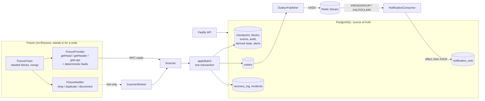

# Chain Event Reliability Sandbox

[](https://github.com/AlinaSchan/chain-event-reliability-sandbox/actions/workflows/ci.yml)

A deterministic sandbox for studying how an EVM event monitor stays correct when things go wrong: head
notifications are lost, events arrive twice, the RPC times out, a worker dies mid-write, Redis redelivers, blocks
are reorganized. It runs locally against PostgreSQL and Redis, talks to nothing else at runtime, needs no paid API,
and every claim below is backed by a test or an executable scenario you can run yourself.

It is an **independent demonstration repository** used to discuss scope. It is not a production backend, it is
not the code of any company or client, and it contains only synthetic data: no keys, no wallets, no live RPC, no
custody, no trading.

The monitored data is a seeded local chain emitting ERC-20 `Transfer` logs and a custom
`SettlementRecorded(bytes32 indexed settlementId, address indexed beneficiary, uint256 amount, uint8 status)`
event. "High value" means at or above a threshold written in whole token units and compared as integers in base
units, with each token's own decimals; there are no fiat values. PostgreSQL holds the authoritative state
(blocks, events, checkpoint, audit trail, transactional outbox); Redis Streams only carries notification messages.

## What this repository demonstrates

- **Progress derived from stored state.** A head notification is only a hint. The scanner compares the provider's
  head with a durable checkpoint and reads block ranges, so lost, repeated or late notifications change *when*
  it scans, never *what* it finds (`Scanner`, `ScannerWorker`).
- **A checkpoint that cannot get ahead of its data.** Blocks, events, derived totals, alerts, audit rows and the new
  checkpoint commit in one PostgreSQL transaction behind a per-chain row lock and a fencing version
  (`applyBatch`, `lockCheckpoint`). Several workers may run; each block is applied once.
- **Event identity that separates a repeat from a reorganization.** `(chainId, blockHash, transactionHash,
  logIndex)`, enforced by the database. The same log delivered twice is one event; the same transaction in a
  different block is a new one and the old one stays as an orphaned row.
- **Atomic, idempotent reorg correction with an audit trail,** and an explicit refusal (halt + diagnostics + incident)
  when no common ancestor exists within the configured rollback depth.
- **A confirmation lifecycle** `observed -> provisional -> confirmed | orphaned` with a configurable depth measured
  from the durable checkpoint, and an incident that asks for a human when a *confirmed* event is orphaned.
- **A transactional outbox in front of Redis Streams,** an idempotent consumer that commits its effect before
  acknowledging, recovery of pending messages (`XAUTOCLAIM`), and repair of a broker that lost its data.
- **Nine executable failure scenarios** (S01-S09), each with a deterministic fixture, fault injection, an expected
  behavior, observable evidence and declared pass/fail checks - and real `SIGKILL` of worker processes.

What it does **not** claim: exactly-once transport (delivery is at-least-once; effects are idempotent), protection
from a provider that is consistently wrong, finality, or any performance figure. See
[Reliability guarantees and limitations](#reliability-guarantees-and-limitations).

## Architecture



1. **Ingest.** A trigger (startup, head notification, reconnect, poll) makes the scanner read the provider's head,
   verify that its stored tip is still the provider's block at that height, fetch headers and logs for the next
   range, validate that the answers fit together, and hand them to `applyBatch`.
2. **Write.** `applyBatch` takes the checkpoint row lock, checks the fencing version, and in one transaction inserts
   blocks and events (insert-if-absent), updates derived totals and alerts for the rows that actually changed, writes
   audit rows, advances the checkpoint, and confirms events that are now deep enough - creating their outbox rows.
3. **Reorganize.** If the stored tip is not the provider's block, the scanner finds the common ancestor and the
   same transaction orphans the abandoned branch, subtracts its effects and applies the replacement.
4. **Deliver.** The publisher moves outbox rows into a Redis stream. The consumer commits a `notification_sink` row
   and the outbox status in one transaction, *then* acknowledges. A message that comes back finds its outbox row
   settled and is only acknowledged. If Redis loses messages, rows that were published but never settled are
   re-queued from PostgreSQL.
5. **Observe.** `GET /status`, `/events`, `/alerts`, `/scenarios`, `/metrics` read the same tables.

Details, including the table of what shares a transaction, are in [docs/architecture.md](docs/architecture.md).

## Repository structure

| Path | What is there |
| --- | --- |
| `src/domain/` | Event identity, exact unit arithmetic, ABI decoding (viem), lifecycle rules, watchlist validation. No I/O. |
| `src/fixtures/` | **Fixture:** seeded EVM-shaped chain, provider with fault injection, head notifier. |
| `src/ingestion/` | **Ingestion:** `scanner.ts` (range scan, tip check, reorg detection), `apply.ts` (the single write path), `prepare.ts` (response validation), `worker.ts`, `retry.ts`. |
| `src/confirmation/` | provisional -> confirmed, and creation of confirmation notifications. |
| `src/recovery/` | **Recovery:** `reorg.ts` (atomic correction), `invariants.ts` (stored-state checks). |
| `src/storage/`, `migrations/` | Pool and transactions, migration runner, checkpoint access; the schema. |
| `src/queue/` | **Redis processing:** outbox publisher, Redis Streams adapter, consumer, pipeline loop, in-process queue double. |
| `src/api/` | Fastify routes, validation, OpenAPI, guarded admin routes. |
| `src/app/` | Configuration, runtime wiring, `main.ts`. |
| `src/observability/` | Structured JSON logging (pino), process counters, crash failpoints. |
| `scenarios/` | **Scenarios** S01-S09, the harness they share with the tests, the oracle, the narrator. |
| `scripts/` | Migrations, scenario runner, demo, OpenAPI and doc generators, SIGKILL helper. |
| `tests/unit/` | No services needed. |
| `tests/integration/`, `tests/fault-injection/` | Real PostgreSQL (and Redis where marked). |
| `docs/` | Architecture, lifecycle, scenarios, invariants, review guide, limitations, scope contract, OpenAPI. |

## Quick start

Requirements: Node.js 22.12 or newer (CI runs 22 and 24) and Docker Compose v2. Without Docker, any PostgreSQL 16+
and Redis 6.2+ reachable through `DATABASE_URL` / `REDIS_URL` will do.

```bash
npm ci                          # or: npm install
cp .env.example .env            # placeholders that match docker-compose.yml
docker compose up -d --wait     # PostgreSQL 17 and Redis 7, bound to 127.0.0.1
npm run db:migrate              # idempotent; checksums applied migrations

npm run demo                    # narrated scenario S04 (reorganization)
npm run scenarios               # all nine failure scenarios, one verdict each
npm test                        # unit + integration + fault-injection tests
npm start                       # the service and its API on http://127.0.0.1:3000
```

`npm run test:unit` needs no services. Tests that need Redis report themselves as **skipped** when `REDIS_URL` is
not set - never as passed - and CI fails if anything is skipped. `npm run typecheck` and `npm run lint` are the
other CI gates.

With the service running: `curl -s localhost:3000/status`, `curl -s 'localhost:3000/events?status=orphaned'`,
`curl -s localhost:3000/openapi.json`. To inject faults into the live fixture chain, set `ADMIN_ENABLED=true` and an
`ADMIN_TOKEN` of 16+ characters; the service then accepts `POST /admin/fixture/reorg`, `/admin/fixture/notifier`,
`/admin/fixture/faults` and others from loopback only, with a bearer token. See [docs/openapi.json](docs/openapi.json).

### Demo output

This is a real run of `npm run demo` (excerpt; the complete transcripts of S04, S01 and S08 are in
[docs/demo-output.txt](docs/demo-output.txt), captured on Windows 11 with Node 24 and PostgreSQL 17; S03 and S07 need
Redis and were captured in GitHub Actions, and are in the same file):

```text
[1 PREPARE FIXTURE] Deterministic fixture chain (seed "S04"): 14 blocks, six events, confirmation depth 3.

[2 BASELINE INGESTION] Baseline ingestion: the scanner stores the canonical chain and its events.
    log info {"event":"scanner.start","chainId":31337,"startBlock":0,"msg":"no checkpoint yet; starting from the configured start block"}
    log info {"event":"backfill.range","chainId":31337,"trigger":"startup","checkpoint":-1,"providerHead":{"number":14,"hash":"0xbfd36d82..."},"from":0,"to":14,"msg":"checkpoint is behind the head; backfilling the range from stored state"}

[3 CANONICAL EVENTS] Canonical events
      block  log  kind      token  amount  status       event
      -----  ---  --------  -----  ------  -----------  -------------
      4      0    Transfer  USDX   20000   confirmed    0x57e412d6…#0
      9      0    Transfer  USDX   15000   confirmed    0x099a9fab…#0
      11     0    Transfer  WRAPX  6       confirmed    0xb444a62a…#0
      12     0    Transfer  USDX   12000   provisional  0x357ddd6d…#0
      13     0    Transfer  GOLDX  150     provisional  0x4d65b059…#0
      14     0    Transfer  USDX   100     provisional  0xbfd36d82…#0

[4 FAULT INJECTION] A competing branch replaces blocks 12-14 with four new blocks; transaction D is re-included, a settlement is added.

[5 PROBLEM DETECTED] The stored tip is no longer the provider's block at that height; parent hashes no longer link.
    - block 12: {"stored":"0x357ddd6d…","provider":"0x6e76b25d…","commonAncestor":11}

[6 RECOVERY] The scanner finds the common ancestor, orphans the abandoned branch and applies the replacement in one transaction.
    log warn {"event":"reorg.detected","chainId":31337,"storedTip":{"number":14,"hash":"0xbfd36d82..."},"providerHead":{"number":15,"hash":"0xccb9c205..."},"commonAncestor":{"number":11,"hash":"0xb444a62a..."},"depth":3,"msg":"stored chain no longer matches the provider; rolling back to the common ancestor"}
    log warn {"event":"reorg.applied","chainId":31337,"commonAncestor":{"number":11,"hash":"0xb444a62a..."},"oldTip":{"number":14,"hash":"0xbfd36d82..."},"newTip":{"number":15,"hash":"0xccb9c205..."},"orphanedBlocks":3,"orphanedEvents":3,"orphanedFromConfirmed":0,"replacementEvents":2,"msg":"reorganization corrected"}
    - scan report: {"outcome":"caught_up","reorgs":1,"blocksIngested":4}

[3 CANONICAL EVENTS] Canonical events after recovery
      block  log  kind                token   amount  status       event
      -----  ---  ------------------  ------  ------  -----------  -------------
      4      0    Transfer            USDX    20000   confirmed    0x57e412d6…#0
      9      0    Transfer            USDX    15000   confirmed    0x099a9fab…#0
      11     0    Transfer            WRAPX   6       confirmed    0xb444a62a…#0
      13     0    Transfer            USDX    12000   provisional  0xec8a4879…#0
      14     0    SettlementRecorded  SETTLE  300000  provisional  0xca1ec43e…#0
    Orphaned events (kept for audit)
      block  log  kind      token  amount  status    event
      -----  ---  --------  -----  ------  --------  -------------
      12     0    Transfer  USDX   12000   orphaned  0x357ddd6d…#0
      13     0    Transfer  GOLDX  150     orphaned  0x4d65b059…#0
      14     0    Transfer  USDX   100     orphaned  0xbfd36d82…#0
    [ OK ] orphaned-events-not-canonical
    [ OK ] replacement-events-processed
    [ OK ] derived-state-corrected
    [ OK ] audit-record-created
```

The run continues with a deeper reorganization that orphans confirmed events (a critical incident requiring manual
review is opened) and one that exceeds the rollback limit (the scanner halts with diagnostics and writes nothing),
and ends with `RESULT  PASS  S04  8/8 declared checks evaluated, 8 passed`.

## Failure scenarios

Each one has a deterministic fixture, fault injection, expected behavior, observable evidence, an executable test and
declared pass/fail checks. The verdict is **PASSED** only if the scenario ran to the end, every check passed, and every
declared check was evaluated; **SKIPPED** (no Redis) is never reported as passed.
[docs/failure-scenarios.md](docs/failure-scenarios.md) has the full description of each, generated from the code.

| ID | Failure | Code responsible | Reproduce |
| --- | --- | --- | --- |
| S01 | Missed notification | `ScannerWorker` (reconnect and poll triggers), `Scanner.step` (range backfill from the checkpoint) | `npm run demo -- --scenario S01` |
| S02 | Duplicate delivery | `prepareBlocks` (duplicate logs in one response), `insertEvents` (`ON CONFLICT` + `RETURNING`), `lockCheckpoint` (racing writers) | `npm run demo -- --scenario S02` |
| S03 | Crash after database commit, before Redis ACK *(Redis)* | `NotificationConsumer.applyEffect` (effect before ack), `RedisStreamQueue.readPending` / `claimStale` | `npm run demo -- --scenario S03` |
| S04 | Chain reorganization | `Scanner.handleReorg` / `findCommonAncestor` / `halt`, `orphanCanonicalAbove` | `npm run demo` |
| S05 | RPC timeouts and bad responses | `withRetry`, `prepareBlocks` (`INCONSISTENT`), `Scanner.scanOnce` (`degraded`) | `npm run demo -- --scenario S05` |
| S06 | Delayed confirmations | `confirmEligible`, `highestConfirmableBlock` | `npm run demo -- --scenario S06` |
| S07 | Outbox delivery failure *(Redis)* | `OutboxPublisher.publishPending` / `requeueStale`, `RedisStreamQueue` | `npm run demo -- --scenario S07` |
| S08 | Restart and replay | `applyBatch` atomicity, `Scanner.scanOnce` resume, `Scanner.replayRange` | `npm run demo -- --scenario S08` |
| S09 | Value threshold and token decimals | `parseUnits`, `isHighValue`, `buildWatchIndex`, `numeric` columns | `npm run demo -- --scenario S09` |

Run them all with `npm run scenarios` (options: `--only S04,S05`, `--json`, `--allow-skipped`). Results are stored in
`scenario_runs` and served by `GET /scenarios/:id`. Beyond the scenarios there are focused tests for the same
behavior, including two scanners racing on one database and worker processes killed with a real SIGKILL
(`tests/fault-injection/hard-kill.test.ts`).

## Data model

Defined in [migrations/](migrations/). Amounts are `numeric` base units; block numbers and ids are `bigint`.

| Table | Purpose and key points |
| --- | --- |
| `scanner_checkpoints` | One row per chain: last committed block number and hash, `scan_status` (`ok` / `degraded` / `halted`) with detail, and a fencing `version`. The writer lock is `SELECT ... FOR UPDATE` on this row. |
| `chain_blocks` | Every block ever stored. `canonical` flag, `orphaned_at`, `orphan_reason`. A partial unique index allows one canonical block per height. Never deleted. |
| `chain_events` | `event_id` primary key = `chainId:blockHash:txHash:logIndex`, also a unique constraint on the four columns. `status`, `status_reason`, `confirm_count`, `seen_count`, `payload_hash`, decoded arguments, exact `amount`. |
| `event_audit` | Append-only history of each event, including repeat sightings. `observed` appears as the `from` of the first transition. |
| `account_flows` | Derived state: inbound / outbound totals per token and account over non-orphaned ERC-20 events. A `CHECK` forbids negative totals. |
| `alerts` | One per high-value event, `open` while it is canonical, `withdrawn` when orphaned. Stores the threshold it was judged against. |
| `outbox` | Notification intent, written in the confirming transaction. Unique `notification_id` (`eventId#type#epoch`), status `pending / published / processed / suppressed`, attempts, errors, duplicate counter. |
| `notification_sink` | Local stand-in for a downstream system: one row per delivered notification (primary key = idempotency key). |
| `recovery_log` | What recovery did: `backfill`, `reorg`, `resume`, `halt`, `unhalt`, `replay`, `outbox_requeue`. Source of "last recovery action". |
| `incidents` | Things that need a human: halted scanner, orphaned confirmed events, payload mismatch, undecodable log. |
| `quarantined_logs`, `scenario_runs`, `schema_migrations` | Undecodable logs kept for inspection; recorded scenario verdicts and evidence; applied migrations with checksums. |

## Reliability guarantees and limitations

**What the tests establish, for the fixture and the faults they inject:**

- the checkpoint never points beyond committed data - crash before COMMIT leaves the old state, crash after keeps the
  new one (in-process failpoints *and* a worker process killed with SIGKILL);
- after any listed failure, the stored canonical events equal the fixture's own record of what it emitted (an
  oracle independent of the scanner and decoder), derived totals equal an independent fold, and the twelve
  stored-state invariants hold;
- a repeated delivery of the same log, block range or notification has no second logical effect;
- orphaned events do not count as canonical, replacement events are processed, the correction is atomic and idempotent;
- nothing is queued for a provisional event, and a notification for an event that is no longer confirmed is not delivered;
- across reorganizations that flip back and forth, a retraction is queued only for a confirmation that was actually
  delivered, for the same confirmation epoch: in 16 seeded random walks - and the same 16 histories again under
  injected provider faults, processes dying at exact lines, a second scanner racing the first and deliveries running
  during reorganizations - a downstream system that only counts `+1` per confirmation and `-1` per retraction ends up
  holding exactly the events that are live on the fixture's chain;
- thresholds are compared as integers: the boundary one base unit either side is classified correctly for 0-, 2-, 6-
  and 18-decimal tokens, including values above 2^53.

**What is not guaranteed** (full list in [docs/known-limitations.md](docs/known-limitations.md)):

- Delivery is **at-least-once**, unordered. This project does not claim exactly-once transport; it makes effects idempotent.
- A **provider that is consistently wrong** is believed; there is no second source and no logs-bloom check, so an
  incomplete log range from a self-consistent provider is not detected until a replay.
- **Confirmation depth is not finality.** A reorganization deeper than the depth is corrected and escalated, but
  effects outside this system cannot be undone.
- No poison-message handling, no pruning, no jitter, no measured performance, and the Redis restart is simulated
  (stream deleted, workers SIGKILLed) rather than performed on a container.

CI runs typecheck, lint, the unit suite, the integration and fault-injection suites against real PostgreSQL 17 and
Redis 7, and the nine scenarios, on Node 22 and 24, for every push to `main` and every pull request. Tests that need
Redis were executed in CI; the machine this was developed on had no Docker, so there they are skipped.

## Review questions for external contributors

The full guide, with a reading order and where each answer lives, is [docs/review-guide.md](docs/review-guide.md).

1. Is checkpoint advancement correctly coupled to durable event persistence?
2. Can replay or consumer redelivery create duplicate logical effects?
3. Does the reorganization procedure handle canonical-state corrections consistently?
4. What happens if Redis becomes unavailable after a successful database commit?
5. Which failure could still cause a silent event gap?
6. Are event identity and notification identity appropriately separated?
7. Which recovery assumptions would need to change for a real multi-provider deployment?

Reading the repository is not a request for unpaid work or a pull request.

## Relationship to the PDF brief

The proposed pilot has two documents. The **PDF brief** describes the scope of a paid, fixed-scope review: what would be
reviewed, deliverables, timeline, effort and terms. **This repository** is the reference implementation that the scope
refers to. [docs/scope-contract.json](docs/scope-contract.json) holds the facts both must agree on (title, implemented
and proposed components, scenario ids, deliverables, exclusions, indicative duration of 2-3 weeks and 16-20 hours,
compensation status). The fee has not been agreed; final terms are subject to written agreement.

## Security and scope

- Synthetic data only. Addresses are hashes of labels; nobody holds a key for them.
- No private keys, seed phrases, API keys or production connection strings. `.env.example` contains placeholders that
  match `docker-compose.yml`, which binds PostgreSQL and Redis to `127.0.0.1`. A unit test scans the repository for
  secret-shaped strings.
- The service makes no outbound network calls other than to the configured PostgreSQL and Redis. There is no mainnet
  logic and no transaction submission. Any future read-only RPC adapter would be disabled by default.
- The read API is unauthenticated and listens on loopback by default (and logs a warning if told otherwise). Admin and
  fault-injection routes exist only with `ADMIN_ENABLED=true`, need a bearer token of 16+ characters, and the service
  refuses to start with them on a non-loopback address.
- No real or third-party webhook is ever called: the "downstream system" is a local table.

## Documentation

[architecture](docs/architecture.md) - [event lifecycle and identity](docs/event-lifecycle.md) -
[failure scenarios](docs/failure-scenarios.md) - [reliability invariants](docs/reliability-invariants.md) -
[review guide](docs/review-guide.md) - [known limitations](docs/known-limitations.md) -
[scope contract](docs/scope-contract.json) - [OpenAPI](docs/openapi.json) - [demo transcripts](docs/demo-output.txt)

## License

MIT - Copyright (c) 2026 Logos (https://logos.co/). See [LICENSE](LICENSE).
