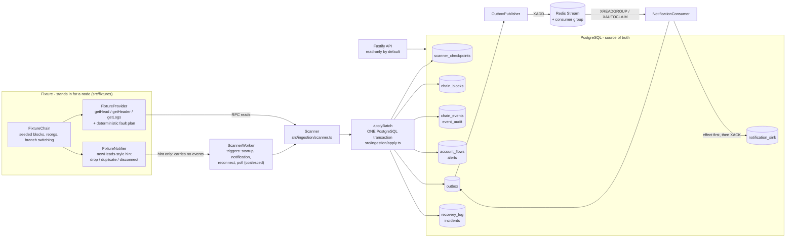

# Architecture

This document explains how the sandbox is put together and, more importantly, **where the transaction
boundaries are**, because every reliability property in this project is a statement about one of them.
All data is synthetic; there is no live network, no key, and no value anywhere in the system.

## Components

| Layer | Code | Role |
| --- | --- | --- |
| Domain | `src/domain` | Event identity, exact integer unit arithmetic, ABI decoding (viem), lifecycle rules. No I/O. |
| Fixture | `src/fixtures` | A deterministic EVM-shaped chain, a provider with fault injection, a head notifier that can drop, repeat and disconnect. |
| Ingestion | `src/ingestion` | `Scanner` (range scan, tip verification, reorg detection), `applyBatch` (the single write path), `ScannerWorker` (when to scan). |
| Confirmation | `src/confirmation` | provisional -> confirmed, and the only place confirmation notifications are created. |
| Recovery | `src/recovery` | Reorg correction (`orphanCanonicalAbove`) and the stored-state invariant checker. |
| Storage | `src/storage`, `migrations/` | Pool and transaction helper, migration runner, checkpoint access. |
| Queue | `src/queue` | Outbox publisher, Redis Streams adapter, idempotent consumer, an in-process queue double for tests. |
| API | `src/api` | Fastify routes, request validation, OpenAPI, guarded admin routes. |
| Wiring | `src/app` | Configuration loading and validation, runtime assembly, `main.ts`. |
| Evidence | `scenarios/`, `tests/` | Executable failure scenarios S01-S09, the oracle, unit / integration / fault-injection tests. |

## Authority

- **PostgreSQL is the source of truth** for blocks, events, checkpoint, audit, derived state, notification
  intent and notification delivery. Nothing the system claims about the chain depends on Redis.
- **The chain provider is an untrusted reader.** Every answer is checked against stored state: log block hashes
  must match the headers held for those heights, transactions must belong to their block, headers must link.
- **A head notification is a hint.** It is never an input. It can cause a scan; it cannot say what to ingest.
  Progress is derived from the stored checkpoint and block ranges, so a lost, repeated or late notification
  changes when the scan happens, not what it finds.
- **Redis is a delivery mechanism.** Whether a notification took effect is recorded in PostgreSQL, so a Redis
  that loses its data is repaired from the outbox rather than trusted.

## Transaction boundaries

| Operation | In one transaction | Serialization | If the process dies... |
| --- | --- | --- | --- |
| Ingest a batch (`applyBatch`, mode `forward`) | block rows; event rows (insert if absent); derived-state deltas for the rows that insert changed; alert rows; audit rows; quarantined logs; **checkpoint advance**; confirmation sweep and its outbox rows | `SELECT ... FOR UPDATE` on the chain's checkpoint row, then commit only if its `version` equals the one the batch was computed from | before COMMIT: no trace of the batch, old checkpoint. After COMMIT: all of it, new checkpoint. |
| Correct a reorg (mode `reorg`) | everything above, preceded by: abandoned blocks flagged, their events orphaned, their derived-state contribution subtracted, alerts withdrawn, undelivered notifications suppressed, retractions queued for delivered ones, an incident if confirmed events were orphaned, a `recovery_log` row | same | same: the old branch is intact or fully corrected, never half |
| Replay a range (mode `replay`) | inserts what is missing, counts repeat sightings, runs the confirmation sweep; does not move the checkpoint | same lock, no version bump | same |
| Halt | scan status, `recovery_log`, incident | lock + version check | atomic |
| Publish outbox rows | per pass: `XADD` for each row, then `UPDATE ... status = 'published'` | `FOR UPDATE SKIP LOCKED` on pending rows | dies after XADD and before COMMIT: rows stay `pending`, are published again, the consumer discards the duplicate |
| Consume a message | `notification_sink` row + outbox status (or the duplicate counter) | shared lock on the event row, then row lock on the outbox row | dies after COMMIT and before XACK: the message comes back, finds the outbox row settled, and is only acknowledged |
| Re-queue stale rows | `published` -> `pending` for rows with no recorded effect after a threshold | single statement | idempotent |

Two properties follow directly from this table:

1. **The checkpoint cannot get ahead of the data.** It moves in the same transaction as the rows it describes,
   and only to the last block of the batch (or back to the common ancestor after a reorg).
2. **A repeat of any step is harmless.** Events are inserted with `ON CONFLICT (event_id)`; derived state follows
   the rows that statement actually changed (`RETURNING`), not the input; the consumer checks the outbox row
   before acting; the publisher may publish twice.

## Concurrency

Any number of scanner processes may run against one database. The design does not assume one:

- Every write transaction takes the per-chain **checkpoint row lock** first. A second writer waits there.
- The batch carries the checkpoint `version` it was computed from. After the lock, if the version moved, the
  transaction aborts with `StaleCheckpointError` and the scanner starts over from stored state (a lost race, not
  an error; counted in `stale_writer_aborts_total`). A fencing version is used rather than comparing block
  numbers so that a tip that moves away and comes back cannot let a stale batch through.
- **Lock order is events -> outbox** in every path that touches both (reorg correction, confirmation, consumer).
  The consumer takes a *shared* lock on the event row before it decides to deliver, so a reorganization cannot
  orphan the event between the consumer's check and its commit. A deterministic interleaving test covers this
  (`tests/integration/outbox.test.ts`, "a reorg that starts while the consumer holds its locks").
- Extra scanners cost wasted RPC calls, not correctness. There is no leader election; it would only reduce waste.

## Provider failures

- Transient errors (`RpcError.retryable`) are retried with bounded exponential back-off (service default: 5 attempts,
  100 ms doubling to a 2 s cap; the scenarios use 4). A header fetch plus a log fetch is one retry unit, so a response
  is only used if both halves agree. There is no jitter, to keep scenarios deterministic.
- A logs response whose block hashes do not match the headers just fetched (a reorganization landed between the two
  calls) is refused as `INCONSISTENT` and fetched again; nothing from the wrong branch reaches the database.
- When retries run out the cycle ends **without writing**, the checkpoint status becomes `degraded`, and the next
  cycle resumes from the stored checkpoint. `GET /status` shows it.
- A provider whose head is behind the checkpoint is not a reorganization unless its hash at its own height differs
  from ours. A stale cached head is the same case.

## Reorganizations

At the start of each step the scanner confirms that the tip it holds is still the provider's block at that height
(one extra header call when the head moved), so a tip replaced at the same height is found before any new block
exists. The common ancestor is found by walking down comparing stored hashes with the provider's, at most
`MAX_REORG_DEPTH` below the stored tip. If none agrees, the scanner **halts** with the probes it made and opens an
incident instead of rolling back on a guess. `docs/event-lifecycle.md` covers what happens to each event.

## Fault injection

All fault injection is deterministic - by call count, never by chance or wall-clock time.

- `FaultPlan` (provider): timeout, server error, stale response, duplicated logs, lagging head.
- `FixtureNotifier`: disconnect (heads lost, not replayed), drop next N, duplicate next N.
- `CrashPoints` (`src/observability/failpoints.ts`): named points in production code (`scanner.before_commit`,
  `scanner.after_commit`, `publisher.after_publish_before_mark`, `consumer.before_effect_commit`,
  `consumer.after_effect_before_ack`). Arming one makes its next hit throw `InjectedCrash`, which stands in for
  SIGKILL. The wiring in `src/app/runtime.ts` never passes a `CrashPoints` object, so in the service these calls are
  no-ops. `scripts/crash-child.ts` goes further: it runs a worker in its own process and kills it with a real SIGKILL.

## Replacing the fixture with a node

`src/ingestion/ports.ts` defines the two interfaces the scanner depends on: `ChainProvider` (head, header by
number, logs by range) and `HeadNotifier`. A read-only JSON-RPC adapter would implement them. None ships with the
sandbox; adding one is listed as a proposed component in `docs/scope-contract.json`, and
`docs/known-limitations.md` lists what a multi-provider deployment would have to change.

## Configuration

See `.env.example`. `loadConfig` validates everything at startup and reports all problems together; nothing is
silently defaulted when it is malformed. `MAX_REORG_DEPTH` must be at least `CONFIRMATION_DEPTH`. Admin routes
require `ADMIN_ENABLED=true`, a token of 16+ characters and a loopback address, or the service refuses to start.

## What is deliberately absent

No block explorer, no trading logic, no wallet or key handling, no transaction submission, no mainnet execution,
no paid RPC, no price oracle (thresholds are in token units).
