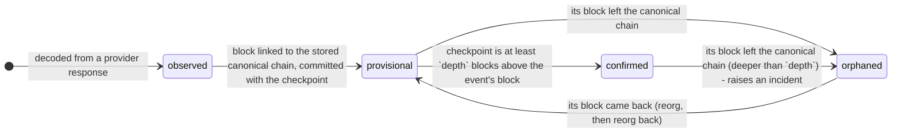
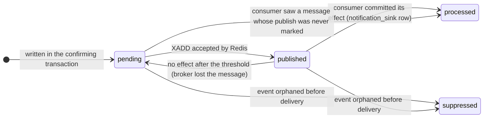

# Event lifecycle, identity and confirmation

## States



| State | Stored? | Meaning |
| --- | :---: | --- |
| `observed` | no | The log has been read and decoded in memory. Nothing is durable yet. It appears in `event_audit` as the *from* side of the first transition (`observed -> provisional`) so the origin of every event is queryable. |
| `provisional` | yes | Stored as part of a block that is linked into the stored canonical chain. May still be reorganized away. No downstream notification exists for it. |
| `confirmed` | yes | At least `CONFIRMATION_DEPTH` blocks sit on top of its block, measured against the durable checkpoint. The only state that produces an external notification. Still not irreversible (see below). |
| `orphaned` | yes | Its block is no longer canonical. Kept for audit, never deleted, excluded from every derived figure. |

**Why `observed` is not a stored status.** Persisting an event before its block is attached to the stored chain
would create a durable row that cannot be attributed to a branch, and a crash would leave it behind. Instead an
event first becomes durable in the same transaction as its block and the checkpoint advance. After a crash the
checkpoint is where it was, nothing "observed" survived, and the next scan reads the same blocks again.

**Why `orphaned -> provisional` exists.** Reorganizations can flip back. If a block that was orphaned becomes
canonical again, its events must return; without that edge they would stay orphaned forever while being
canonical. Such an event carries its history: `ingested`, `orphaned`, `reactivated`.

## Identity and deduplication

An EVM contract log occurrence is identified by

```
event_id = chainId : blockHash : transactionHash : logIndex
```

stored as a primary key **and** as a unique constraint on the four columns, with a `CHECK` that the id matches
its columns (`migrations/001_chain_state.sql`).

| Situation | Key comparison | Result |
| --- | --- | --- |
| Same log delivered again (retry, overlapping range, duplicated RPC response, two workers) | identical | Same row. `seen_count` increases and a `duplicate_sighting` audit row is written. No other effect. |
| Two logs emitted by one transaction | same `transactionHash`, different `logIndex` | Two events. |
| A transaction re-included in a different block after a reorganization | same `transactionHash`, different `blockHash` | A **new** event. The old row is orphaned. |
| A block that was orphaned becomes canonical again | same `blockHash` | The old rows are reactivated, not duplicated. |
| Same identity, different payload | same key, different `payload_hash` | The stored row is kept; a `payload_mismatch` audit row and a critical incident are created. |
| Log from a watched contract that looks like a tracked event but does not decode (for example an ERC-721-shaped `Transfer`) | - | Stored in `quarantined_logs`, incident raised. Never silently dropped. |

`logIndex` is per block in the Ethereum JSON-RPC specification, which is what the fixture models. A real provider
must be checked for the same behavior before this key is trusted.

**Native-value transfers are not implemented.** If they were added, the rule would be `chainId : blockHash :
transactionHash : 'native'` (a transaction has at most one top-level value transfer), kept in a separate event
kind so that it is never mixed with contract logs. Internal transfers would need a trace index in the key.

**Notification identity is separate from event identity.** A notification id is
`eventId#type#epoch`, where `epoch` is the event's `confirm_count` when the notification was created. One event can
legitimately produce several notifications over its life: confirmed (epoch 1), retracted, confirmed again after a
reorg-and-back (epoch 2). Each has exactly one id, so each is delivered at most once in effect.

## Confirmation policy

```
confirmed  <=>  checkpoint.lastBlockNumber - event.blockNumber >= CONFIRMATION_DEPTH
```

- Depth is measured from the **durable checkpoint**, not from the provider's head and not from the clock. A provider
  that is ahead but unreachable confirms nothing; a stalled chain confirms nothing no matter how often it is polled.
- The sweep runs inside the ingestion transaction, so "the checkpoint reached N" and "events up to N - depth are
  confirmed" become visible together.
- Boundary, with depth 4 and an event in block 5: head 8 -> provisional (3 blocks on top), head 9 -> confirmed.
- A late-found event in an already-deep block (found by a replay) is inserted as provisional and confirmed in the
  same transaction; both transitions are in the audit trail.
- `CONFIRMATION_DEPTH` is a heuristic, not finality. This sandbox does not read `safe` / `finalized` tags.

### A confirmed event can still be orphaned

If a reorganization is deeper than the confirmation depth, confirmed events are orphaned. The system corrects its
own state (and does so atomically), but it **cannot undo effects outside itself**, and it says so:

1. An incident `confirmed_event_orphaned` (severity `critical`, `requires_manual_review = true`) is opened,
   listing the confirmed events and which of them had already been delivered.
2. Notifications for those events that had not been delivered are marked `suppressed`.
3. For notifications that *had* been delivered, an `event_retracted` notification is queued (same outbox, same
   delivery guarantees). Whether a retraction is enough is a business decision; hence the incident.
4. `GET /status` shows `openIncidents` and the last recovery action; the Prometheus gauge
   `cers_incidents_requiring_manual_review` is non-zero.

If no common ancestor exists within `MAX_REORG_DEPTH`, the scanner halts (`scan_status = 'halted'`), writes
nothing, records the probes it made in `scanner_checkpoints.status_detail`, and waits for an operator
(`POST /admin/scanner/unhalt` or `Scanner.unhalt`). Clearing a halt without changing anything just halts again.

## Reorganization procedure

1. A step finds that the stored tip is not the provider's block at that height, or that the next block's parent hash
   does not match the stored tip.
2. Walk down from `min(stored tip, provider head)` comparing stored and provider hashes until they agree: the common
   ancestor. Stop at `MAX_REORG_DEPTH` or at the start block -> halt.
3. Fetch the replacement branch (one batch), verify it attaches to the ancestor.
4. In one transaction: flag the abandoned blocks non-canonical with a reason; orphan their events; subtract their
   contribution from `account_flows`; withdraw their alerts; suppress undelivered notifications and queue retractions
   for delivered ones; open an incident if any confirmed event was orphaned; insert the replacement blocks and
   events; move the checkpoint; run the confirmation sweep; write the `recovery_log` entry.
5. Further replacement blocks arrive as ordinary forward batches.

The correction is idempotent because every statement only matches rows that are still canonical / not yet orphaned
(running it again changes nothing), and it is atomic because it is one transaction guarded by the checkpoint lock.

## Notification lifecycle (outbox)



- `processed` rows have exactly one `notification_sink` row; the consumer re-checks that the event is still
  confirmed in the same epoch before delivering, as defence in depth.
- Nothing is queued for a `provisional` event. There is no configuration that changes this; allowing it would
  need its own policy.
